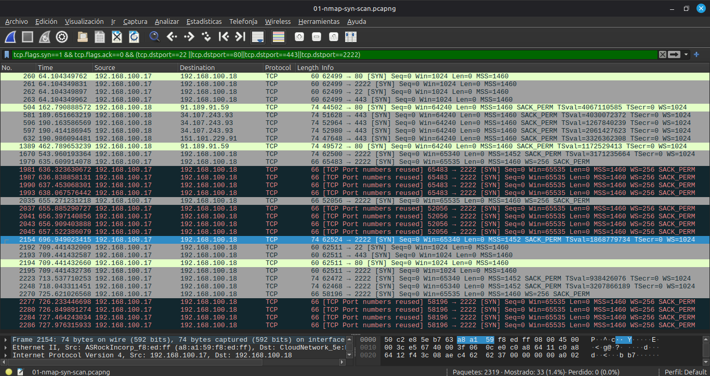
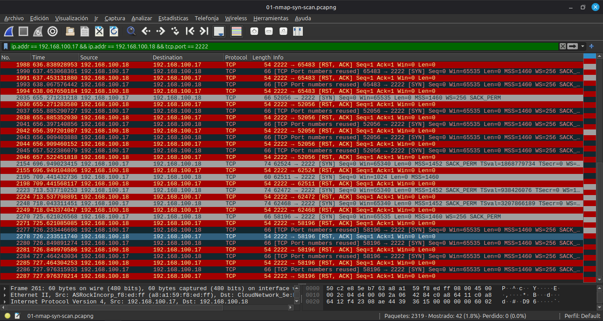

# 🔍 Network Traffic Forensics & Intrusion Analysis with Wireshark

## 📌 Project Overview
Packet-level network analysis is a core skill for Tier 1 SOC Analysts to validate SIEM alerts and investigate suspicious communications. This project demonstrates a hands-on forensic investigation using **Wireshark** to capture, filter, and analyze simulated reconnaissance (**Nmap SYN Scan**) and repeated connection attempts across a local network environment.

---

## 🏗️ Lab Environment
* **Adversary Workstation:** Windows 11 Pro with WSL2 (Kali Linux) (`192.168.100.17`) executing `Nmap`, `SSH`, and `cURL` probes.
* **Target / Sensor Host:** Linux Mint workstation (`192.168.100.18`) capturing live interface packets via **Wireshark**.
* **Artifact Included:** Raw packet capture available in `pcap/network-intrusion-capture.pcapng` for independent verification.

---

## 🔬 Forensic Investigation & Packet Analysis

### 1. Detecting Nmap Stealth SYN Scan (Reconnaissance)
Using a custom Wireshark display filter to isolate incoming TCP `SYN` packets without `ACK` flags across common service ports (`22, 80, 443, 2222`):

```text
tcp.flags.syn == 1 && tcp.flags.ack == 0 && (tcp.dstport == 22 || tcp.dstport == 80 || tcp.dstport == 443 || tcp.dstport == 2222)
```



#### Key Forensic Findings:
* **Scanner Signature:** Packets `#260–#263` show `192.168.100.17` probing ports `80, 2222, 22, 443` within **2 milliseconds** using a fixed TCP Window Size (`Win=1024`) and `MSS=1460`—a classic fingerprint of an **Nmap SYN Stealth Scan** (**MITRE ATT&CK `T1046` - *Network Service Discovery***).

---

### 2. Analyzing Repeated Port Probing & Connection Resets (`Port 2222`)
To investigate targeted activity against the non-standard SSH port (`2222`), traffic between both endpoints was isolated:

```text
ip.addr == 192.168.100.17 && ip.addr == 192.168.100.18 && tcp.port == 2222
```



#### Key Forensic Findings:
* **Connection Refusal Pattern:** The target host (`192.168.100.18`) immediately responds to incoming `SYN` requests with `[RST, ACK]` packets (`Seq=1 Ack=1 Win=0`), confirming the port was closed during the probe window.
* **Automated Retries:** Multiple `[TCP Port numbers reused]` flags indicate rapid automated connection attempts (`SSH` / `cURL` probes) originating from the same adversary IP.

---

## 🛡️ SOC Mitigation & Hardening Recommendations
1. **Intrusion Prevention (IPS):** Deploy **Suricata** or **Snort** rules to detect and drop high-rate `SYN` scans (`threshold: type both, track by_src`).
2. **Host Firewall Filtering:** Configure `UFW` or `iptables` to silently `DROP` unauthorized inbound packets rather than sending `RST` responses, reducing attacker visibility during enumeration.
3. **Network Segmentation:** Isolate administrative management ports (`22`, `2222`) behind a dedicated management VLAN or VPN.
